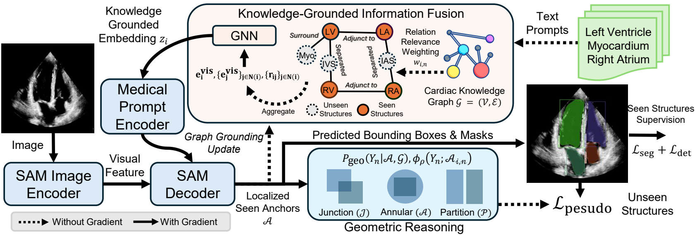
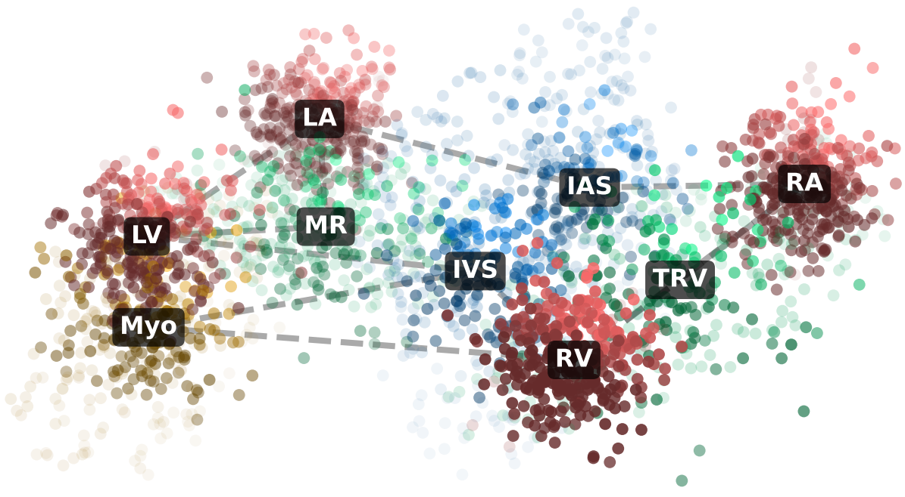
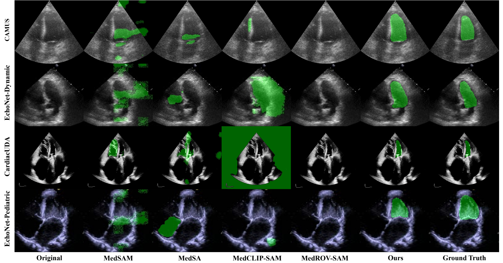
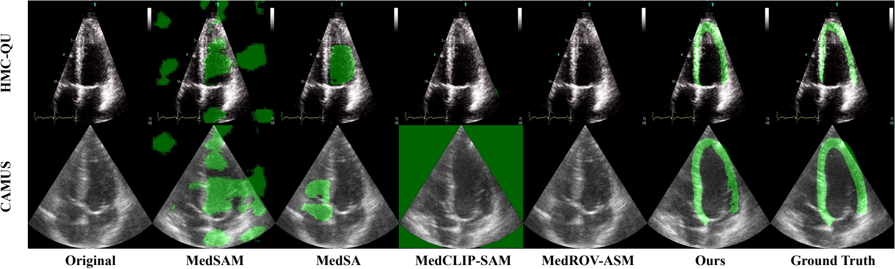
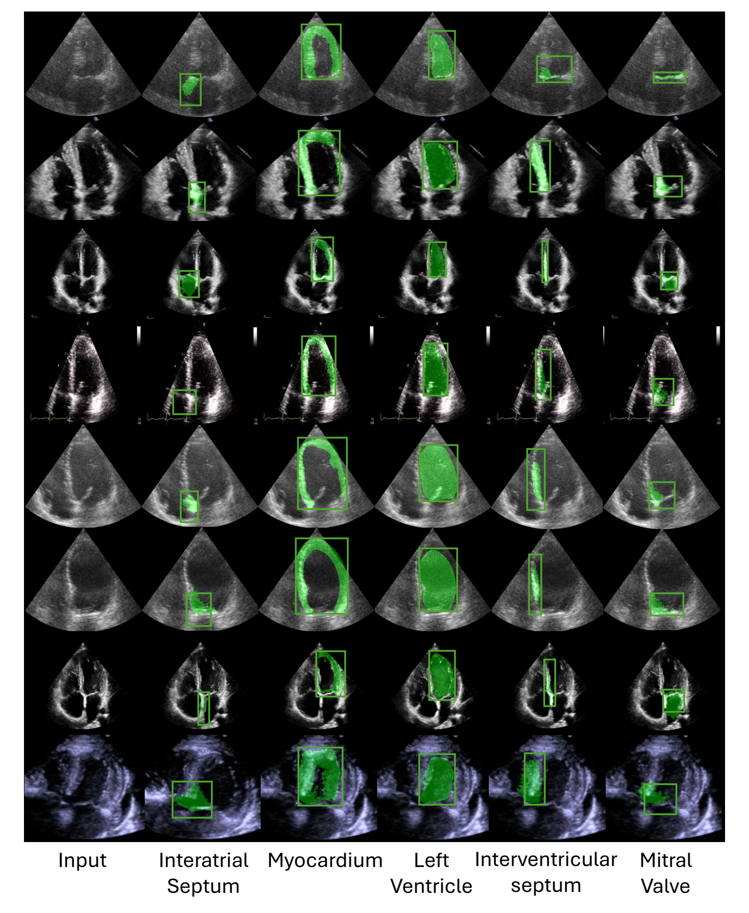

<h1 align="center">
  Echo-SAM: Zero-Shot Learning of Unseen Structures<br>
  via Medical Knowledge Graph Grounding
</h1>

<p align="center">
  <b>Jiewen Yang · Xiaomeng Li</b><br>
  The Hong Kong University of Science and Technology
</p>

<p align="center">
  <b>NeurIPS 2026</b> ·
  <a href="https://neurips.cc/virtual/2026/loc/sydney/poster/152656">Paper</a>
</p>

<p align="center">
  <a href="#method">Method</a> ·
  <a href="#setup">Setup</a> ·
  <a href="#training">Training</a> ·
  <a href="#evaluation">Evaluation</a> ·
  <a href="#results">Results</a> ·
  <a href="#citation">Citation</a>
</p>

Echo-SAM studies **zero-shot echocardiographic segmentation of unseen anatomical structures**. It combines SAM 3 with a cardiac knowledge graph, knowledge-grounded prompt fusion, and geometric support inference to localize targets through their relationships with visible anatomical anchors.

This repository contains the model, medical knowledge graph, geometric reasoning utilities, pseudo-label losses, training configurations, evaluation code, and visualizers. The Python package retains the `sam3` name used by the implementation.

## Method



**Framework.** Anatomical knowledge grounds visual and text representations, while graph relations provide geometric support for unseen structures. [Original PDF](assets/figures/overview.pdf)

<p align="center">
  
</p>

**Medical knowledge graph.** Cardiac chambers, valves, muscle, myocardium, and great vessels are connected through anatomical relationships. [Original PDF](assets/figures/knowledge_graph.pdf)

- **Knowledge grounding:** node and edge representations supply anatomical context to the text prompts.
- **Geometric reasoning:** visible structures provide spatial references for proposing unseen cavities, myocardial regions, septa, and valves.
- **Pseudo-label supervision:** inferred masks and boxes provide auxiliary supervision without dense annotations for the unseen targets.

The main zero-shot protocol trains with **LA, RA, and RV** annotations from CardiacUDA. **LV and myocardium (Myo)** annotations are excluded from training and model selection and used only for offline evaluation.

| Component | Implementation |
| --- | --- |
| SAM 3 model construction | [model_builder.py](sam3/model_builder.py) |
| Knowledge graph and prompt fusion | [medical_knowledge.py](sam3/model/medical_knowledge.py) |
| Cardiac ontology and descriptions | [ultrasound_cardiac_knowledge.json](sam3/train/configs/ultrasound_cardiac/ultrasound_cardiac_knowledge.json) |
| Geometric support utilities | [geometric_reasoning.py](sam3/model/geometric_reasoning.py) |
| Image model and knowledge integration | [sam3_image.py](sam3/model/sam3_image.py) |
| Medical pseudo-label objective | [medical_aux_loss.py](sam3/train/loss/medical_aux_loss.py) |
| Segmentation metrics | [coco_eval_offline.py](sam3/eval/coco_eval_offline.py) |

The remaining SAM 3 model, data, training, video, agent, and evaluation modules are retained to preserve the supplied implementation and its dependencies.

## Setup

Use Linux, Python 3.12, and an NVIDIA GPU for model execution. Install a CUDA-enabled PyTorch build compatible with your driver. The release checks use PyTorch 2.10.0 and torchvision 0.25.0 with CUDA 12.6; this is a packaging verification environment, not a claim about the original experiment environment.

```bash
git clone https://github.com/xmed-lab/Echo-SAM.git
cd Echo-SAM

conda create -n echo-sam python=3.12 -y
conda activate echo-sam
python -m pip install torch==2.10.0 torchvision==0.25.0 \
    --index-url https://download.pytorch.org/whl/cu126
python -m pip install -e '.[train]'
```

Run commands below from the repository root. Use a separate environment from an upstream SAM 3 installation because both expose the `sam3` import namespace.

### Prepare weights and data

1. Obtain the base `sam3.pt` checkpoint through the [official SAM 3 project](https://github.com/facebookresearch/sam3#installation). Follow its checkpoint access instructions and terms.
2. Prepare image frames and COCO instance-segmentation JSON files. The supplied loaders expect `images`, `annotations`, and `categories`, with category IDs matching the prompt definitions.
3. Set your local paths:

```bash
export ECHO_SAM_DATA_ROOT=/path/to/UltrasoundCardiac
export SAM3_CHECKPOINT=/path/to/sam3.pt
```

The cardiac YAML files use these variables, repository-relative tokenizer and knowledge-graph paths, and an optional `ECHO_SAM_OUTPUT_DIR` for outputs. Datasets and model weights are not included.

<details>
<summary>Directory layout used by the supplied configurations</summary>

```text
UltrasoundCardiac/
├── CardiacMV-A4C-ExLV/
│   └── train/
│       ├── _annotations.coco.json
│       └── <image files referenced by the JSON>
├── CardiacMV-A4C/
│   └── test/
│       ├── _annotations.coco.json
│       └── <image files>
└── HMC-QU/
    └── test/
        ├── _annotations.coco.json
        └── <image files>
```

`CardiacMV-*` names are retained from the original configurations. Map them to your prepared data through `all_ultrasound_cardiac_supercategories` in each YAML file. Other evaluation datasets can use the same COCO layout.

For the paper's zero-shot protocol, retain only LA/RA/RV annotations in training and model-selection validation JSONs. The supplied training YAML points its validation loader at `CardiacMV-A4C/test`; change that entry to a separate validation split containing only seen-category annotations before training. Reserve target-labeled test JSONs for offline evaluation. A folder name such as `ExLV` alone does not verify annotation filtering.

</details>

## Training

The zero-shot configuration is [ultrasound_cardiac_zero_shot_lv_myo.yaml](sam3/train/configs/ultrasound_cardiac/ultrasound_cardiac_zero_shot_lv_myo.yaml). After preparing the data and adjusting the validation split above:

```bash
CUDA_VISIBLE_DEVICES=0,1 python -m sam3.train.train \
    -c configs/ultrasound_cardiac/ultrasound_cardiac_zero_shot_lv_myo.yaml \
    --use-cluster 0 --num-gpus 2
```

The supplied configuration uses one image per GPU, gradient accumulation of 1, bfloat16 mixed precision, 10 epochs, and pseudo-label weight 0.1. It disables few-shot support loading. Change `scratch.train_batch_size`, `trainer.max_epochs`, and GPU count for your environment. Checkpoints, TensorBoard events, predictions, and logs are written under `outputs/zero_shot_lv_myo/` by default.

Additional supplied configurations are preserved for reference:

| Configuration | Current behavior |
| --- | --- |
| `ultrasound_cardiac/ultrasound_cardiac_zero_shot_lv_myo.yaml` | Zero-shot training, few-shot support disabled |
| `ultrasound_cardiac/ultrasound_cardiac_zero_shot_eval.yaml` | Medical model evaluation, HMC-QU test data by default |
| `ultrasound_cardiac/ultrasound_cardiac_full_ft_images.yaml` | Development configuration with HMC-QU 16-shot support enabled |
| `ultrasound_cardiac_few_shot/ultrasound_cardiac_lv_few_shot.yaml` | Development configuration with five CAMUS support examples |
| `ultrasound_cardiac/ultrasound_cardiac_eval.yaml` | Generic SAM 3 evaluation with the medical wrapper disabled |

The file named `full_ft_images` currently enables few-shot support; its filename does not identify the paper's fully supervised benchmark recipe. The support-based configurations are separate from the zero-shot protocol.

## Evaluation

Set `ECHO_SAM_CHECKPOINT` to an Echo-SAM checkpoint saved by the trainer. `SAM3_CHECKPOINT` still refers to the base SAM 3 checkpoint used for model initialization.

```bash
export ECHO_SAM_CHECKPOINT=/path/to/echo_sam/checkpoint.pt

CUDA_VISIBLE_DEVICES=0 python -m sam3.train.run_eval \
    -c ultrasound_cardiac/ultrasound_cardiac_zero_shot_eval.yaml \
    --num-gpus 1
```

Update the `val.img_folder` and `val.json` entries in [the evaluation configuration](sam3/train/configs/ultrasound_cardiac/ultrasound_cardiac_zero_shot_eval.yaml) to select your prepared CAMUS, HMC-QU, EchoNet-Dynamic, EchoNet-Pediatric, or CardiacUDA test set. Evaluation outputs default to `outputs/zero_shot_eval/`.

The evaluator writes COCO predictions and reports Dice, IoU, HD95, and ASSD, including per-category scores. Overlap metrics are fractions; multiply by 100 for percentage reporting. Boundary distances use pixel units. The supplied implementation excludes infinite distances from boundary-metric averages.

### Visualize geometric pseudo targets

The diagnostic below reads the annotations in one COCO image and visualizes the geometric proposals derived from them:

```bash
python -m sam3.train.pseudo_example \
    --img_folder "$ECHO_SAM_DATA_ROOT/CardiacMV-A4C-ExLV/train" \
    --json "$ECHO_SAM_DATA_ROOT/CardiacMV-A4C-ExLV/train/_annotations.coco.json" \
    --img_idx 0 --save pseudo_targets.png
```

For a zero-shot diagnostic, its input JSON must contain only seen annotations. This visualizer uses provided annotations as anchors; it is not prediction-only inference.

## Results

The following DSC values (%) are reported in the manuscript; they have not been remeasured as part of this source release.

| Unseen target | Dataset | DSC (%) |
| --- | --- | ---: |
| LV | CardiacUDA | 65.72 |
| LV | CAMUS | 49.39 |
| LV | EchoNet-Dynamic | 57.40 |
| LV | EchoNet-Pediatric | 58.99 |
| Myo | CAMUS | 60.24 |
| Myo | HMC-QU | 57.09 |



**Left ventricle.** Qualitative comparisons across datasets. [Original PDF](assets/figures/zero_shot_lv.pdf)



**Myocardium.** Qualitative comparisons on CAMUS and HMC-QU. [Original PDF](assets/figures/zero_shot_myo.pdf)

<details>
<summary>Additional unseen structures</summary>



[Original PDF](assets/figures/additional_structures.pdf)

</details>

## Citation

```bibtex
@inproceedings{yang2026echosam,
  title     = {{Echo-SAM}: Zero-Shot Learning of Unseen Structures via Medical Knowledge Graph Grounding},
  author    = {Yang, Jiewen and Li, Xiaomeng},
  booktitle = {Advances in Neural Information Processing Systems},
  year      = {2026},
  url       = {https://neurips.cc/virtual/2026/loc/sydney/poster/152656}
}
```

## Acknowledgements and license

We thank [SAM 3](https://github.com/facebookresearch/sam3) and its contributors for the foundation model and code, and the creators of CardiacUDA, CAMUS, HMC-QU, EchoNet-Dynamic, and EchoNet-Pediatric for their research datasets.

The inherited SAM 3 code is subject to the [SAM License](LICENSE). Upstream copyright notices are preserved. See [NOTICE](NOTICE) for attribution and licensing scope.
